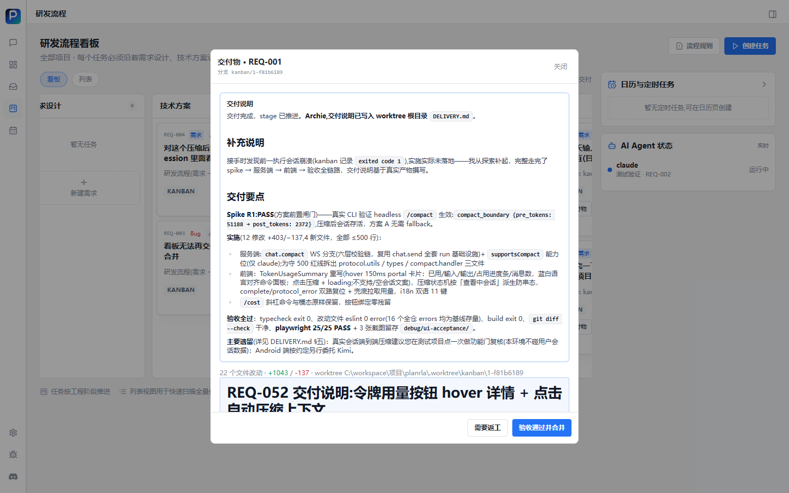

# kanban task #2 交付说明:可视化验证必须截图留证(测试验证环节工程化)

> 分支:`kanban/2-41cae793`(基于 main @ `5284c5a`)
> 日期:2026-08-28 · 6 commits · 21 files,+1033 / −22
> 方案:`docs/design/2026-08-28-kanban-ui-screenshot-evidence-design.md`
> 验证记录:`debug/verification-task2.md`(命令输出、迁移实测、失败与重试说明)

## 一、完成内容

### 1. 模板固化:v2 单源化 + seedVersion 磁盘迁移(需求 1)

- **模板定义单源**:sdlc-default 的 seed 从 `assembly.ts` 内联提取到新模块 `server/modules/kanban/sdlc-default-template.ts`(单一事实源),导出 `SDLC_DEFAULT_SEED_VERSION = 2`、`buildSdlcDefaultTemplate()`、`migrateSdlcDefaultSeed()`、`preserveSeedVersion()`。
- **v2 文案**:
  - ss3「测试验证」:UI/可视化改动**强制** playwright 无头真实打开页面截图留证 → `debug/ui-acceptance/`(文件名含任务编号与场景,如 `task{{task_number}}-hover-popover.png`);脚本留存 `debug/` 可复跑;页面不可达先起 dev server;纯后端改动可豁免但须声明「本任务无可视化改动」;验证记录末尾列截图清单。
  - ss4「交付」:DELIVERY.md 必须含「验证证据」小节,markdown 图片语法列全部截图相对路径;无可视化改动须显式声明。
- **迁移策略(seedVersion + 旧版指纹定向覆盖)**:`TaskTemplate.seedVersion?: number`(缺失视为 v1);启动时磁盘模板 seedVersion 落后 → 逐 stage 比对 prompt 是否仍等于旧版原文指纹,**未自改才升级**,用户自改保留并在日志点名;无条件写回新 seedVersion 保证幂等。迁移映射表化,未来 v3 追加条目即可。
- **真实存量适配**:实测本机 `~/.planrla` 磁盘模板 ss4 曾以 `{input}` **单括号**写盘(历史笔误),初版指纹误判「用户自改」→ 指纹改为变体数组,真实写盘过的形态全部收录(commit `26fc453`)。
- **防抹除兜底**:`POST /tasks/templates` 保存 sdlc-default 时若 body 未带 seedVersion,服务端沿用磁盘值(前端编辑器整体保存不感知该标记,否则每次保存都会触发重迁移噪音)。

### 2. 交付说明引用截图路径(需求 2)

由 ss4 v2 文案承接(上),任务自身的 DELIVERY.md 见文末「验证证据」小节(dogfood)。

### 3. 交付物面板渲染验证截图(需求 3,可选增强,已实现)

- **后端**:新模块 `server/modules/kanban/delivery-doc.ts` 的 `resolveDeliveryDocImages()`——GET `/:taskId/delivery-doc` 返回前,把 DELIVERY.md 中**真实存在于 worktree** 的相对路径图片(``)改写为绝对路径;`existsSync` 不通过原样保留(「声明了但文件缺失」本身是验收信号);防 `..` 越界(containment 用 `path.relative` 判定);http(s)/file/data/绝对路径不动。
- **前端**:`DeliverablePanel` 的 `deliveryDoc` 从 `<pre>` 纯文本改为复用已有的 `<Markdown>` 组件(同文件已 import),绝对路径图片自动走 `/api/providers/local-image` 代理——验收人在面板内直接看到仓库内截图,免切文件夹。

## 二、改动文件清单

| 类别 | 文件 | 说明 |
|---|---|---|
| 方案 | `docs/design/2026-08-28-kanban-ui-screenshot-evidence-design.md` | 技术方案(选型/改动点/风险) |
| 核心 | `server/modules/kanban/sdlc-default-template.ts` **(新)** | v2 模板定义 + 迁移 + 兜底,~150 行 |
| 核心 | `server/modules/kanban/delivery-doc.ts` **(新)** | 相对路径截图解析,~40 行 |
| 核心 | `server/modules/kanban/types.ts` | `seedVersion?: number` |
| 核心 | `server/modules/kanban/assembly.ts` | seed 改用构建函数 + 启动迁移接线 |
| 核心 | `server/modules/kanban/kanban.routes.ts` | delivery-doc 套用解析;templates POST 兜底 |
| 核心 | `src/components/workbench/pages/WorkflowPage.tsx` | `deliveryDoc` `<pre>` → `<Markdown>` |
| 测试 | `server/modules/kanban/tests/sdlc-default-template.test.ts` **(新)** | v2 文案断言 + 迁移矩阵(升级/自改跳过/幂等/单括号变体)+ 兜底 |
| 测试 | `server/modules/kanban/tests/delivery-doc.test.ts` **(新)** | 解析矩阵(存在/缺失/外部/越界/语法变体) |
| 测试 | `server/modules/kanban/tests/prompt.test.ts` | ss3 渲染含截图要求 + `{{task_number}}` 替换 |
| 测试 | `server/modules/kanban/tests/template-routes.test.ts` | 保存保留 seedVersion;非内置模板不注标记 |
| 留证 | `debug/capture-task2-ui.mjs`、`debug/capture-task2-detail.mjs` | playwright 无头截图脚本(可复跑) |
| 留证 | `debug/task2-e2e-fixture.mjs`、`debug/capture-task2-deliverable-panel.mjs` | 备用隔离 fixture 方案(独立 DATABASE_PATH) |
| 留证 | `debug/verification-task2.md`、`debug/ui-acceptance/task2-*.png` ×5 | 验证记录与截图 |

## 三、使用 / 合并方式

- 验收通过后以 merge commit 并入主仓当前分支(kanban 标准流程);无 db schema 迁移、无新增依赖、无 env 变更,合并即生效。
- **已有部署环境**:下次启动 server 时自动把磁盘 `sdlc-default` 迁移到 v2(仅覆盖未自改的 ss3/ss4 prompt);用户自改过的 stage 保留原样并在日志点名,需手动参考新版文案。
- 复跑可视化验证:起 dev(`SERVER_PORT=3210` + vite `:5180`)后 `node debug/capture-task2-ui.mjs`(需 `debug/.capture-token` 本地 JWT,不入库;构造方式见 `debug/verification-task2.md` §4)。

## 四、遗留事项

1. **模板编辑器 UI 提示**(方案风险 #1 的后续):用户自改过 ss3/ss4 时迁移跳过,当前仅日志点名;后续可在前端模板编辑器展示「内置模板已更新」提示(不在本期)。
2. **验收硬校验**(风险 #2 的后续):prompt 是软约束;后续可加验收门——`debug/ui-acceptance/` 非空或 DELIVERY.md 含「本任务无可视化改动」声明,二者必居其一(不在本期)。
3. `kanban.routes.ts` 存量 505 行超文件卫生线(本任务 +12 行,增量部分逻辑均在新模块,路由层仅接线);后续拆分 templates CRUD 段(不在本期)。
4. 全量测试套件 4 个**存量**失败(projectsDb×2、providerMcpService×2),经基线复跑与本次改动无关,建议另开任务修复。
5. `debug/e2e-fixture/auth.db` 被残留进程占用未能清理,本地临时文件不入库,可手动删除。

## 五、验证证据

命令验证:tsc server/web 均 exit 0;eslint 0 errors;kanban 模块单测 40/40;全量套件 441/445(4 失败为存量,基线确认)。详见 `debug/verification-task2.md`。

磁盘迁移实测:本机 v1 模板启动后自动升级 v2,ss3/ss4 均含截图要求;单括号变体已收录指纹。

可视化验证(playwright 无头,真实页面):

> 面板截图验证复用任务 #1(REQ-052)真实现场,其 DELIVERY.md 曾临时注入图片语法,已还原(git 复核干净)。
