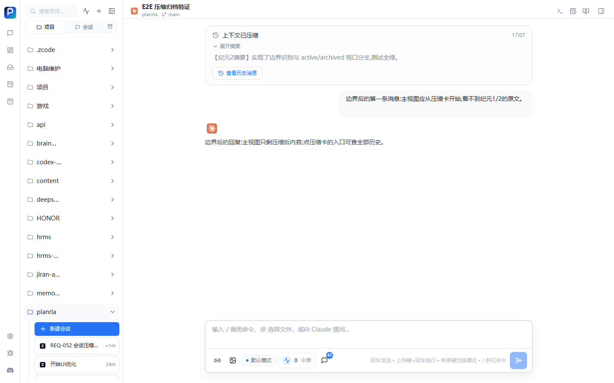

# DELIVERY — REQ-052 会话压缩归档(kanban task #4)

> 分支:`kanban/4-53c5777f` · 日期:2026-08-29 · 实施:hub(server/集成/验收)+ Kimi via A2A(前端 UI)
> 设计文档:`docs/superpowers/specs/2026-08-28-req052-compact-archive-design.md`
> 需求池:`docs/process/BACKLOG.md` REQ-052(四要素齐)

## 完成内容

压缩(compact)后,主会话视图只渲染「最后一个压缩边界之后」的消息;边界前历史经新的「历史消息查询」面板按纪元浏览。解决长会话「对话太多」的整读/整渲染问题。

- **压缩触发事件(live)**:`claude` provider 归一化层新增 `compact_boundary` kind,映射 SDK `{type:'system', subtype:'compact_boundary'}` 事件(此前被静默丢弃),经 WS 下发(自动获得 seq/重放语义)。
- **压缩边界(历史)**:Claude JSONL 中按**文件顺序**识别 `isCompactSummary` 行为边界(不依赖 timestamp 排序,同毫秒行不扰动边界)。
- **视口口径**:`fetchHistory` 增 `view=active|archived|all` + `epoch`;**缺省 `all` 与现状逐字节兼容**(session-query MCP、kanban digest、REQ-049 fork 快照零改动零回归)。
  - `active`:最后边界(含摘要行)之后 → 聊天主视图;
  - `archived`:指定纪元边界前消息(纪元摘要行收口)+ 尾分页;
  - `compaction` 元数据(`archivedMessages` 惰性:`active` 口径返回 null,精确计数在 `GET …/compactions` 时计算并回写缓存)。
- **纪元列表端点**:`GET /api/providers/sessions/:id/compactions`,不支持的 provider 返 `supported:false`(前端隐藏入口)。
- **缓存表** `session_compactions`(epoch/boundary_uuid/trigger/pre_tokens/archived_messages):纯缓存,过滤事实源始终是 JSONL 现算——表与文件永远打不了架。
- **前端**:主视图与搜索全量加载切 `view=active`;realtime 收到 `compact_boundary` → 清空 realtime 缓冲 + 400ms 防抖按 active 换血主视图 + 顶部横幅;`isCompactSummary` 渲染为可折叠「上下文已压缩」卡(`CompactSummaryCard`,归档入口);`ArchiveMessagesPanel`(独立取数,不污染主 store slot;纪元切换/计数徽章/尾分页「加载更早」/空态降级);i18n zh-CN/en。

## 改动文件清单

Server(hub 实施):
| 文件 | 改动 |
|---|---|
| `server/shared/types.ts` | `compact_boundary` kind、`CompactionView`/`CompactionEpochInfo`、`FetchHistoryOptions.view/epoch`、result `view/hasArchived/compaction` |
| `server/shared/interfaces.ts` | `IProviderSessions.listCompactions?` |
| `server/modules/database/schema.ts` | `session_compactions` 表(INIT_SCHEMA,启动自建) |
| `server/modules/database/repositories/sessions.db.ts` | `upsertCompactionEpoch` / `listCompactionEpochs` |
| `server/modules/providers/list/claude/claude-sessions.provider.ts` | 边界识别(文件序)、视口分支、`compact_boundary` 归一化、`listCompactions` |
| `server/modules/providers/services/sessions.service.ts` | `fetchHistory` 透传 view/epoch + `listCompactions`(不支持返 supported:false) |
| `server/modules/providers/provider.routes.ts` | messages 端点 `view/epoch` 参数校验 + `GET …/compactions` |
| `server/modules/providers/tests/claude-compact.test.ts` | **新增** 10 个用例(边界/视口/分页/同毫秒/双纪元/缓存/live 帧) |

Frontend(Kimi via A2A 实施,hub review):
| 文件 | 改动 |
|---|---|
| `src/stores/useSessionStore.ts` | `CompactionView`/`CompactionInfo` 类型、slot `view/hasArchived/compaction`、fetch 带 view/epoch |
| `src/components/chat/hooks/useChatSessionState.ts` | 首屏/搜索全量加载切 `view: 'active'`,暴露 `hasArchivedMessages/compactionInfo` |
| `src/components/chat/hooks/useChatRealtimeHandlers.ts` | `compact_boundary` 帧:清缓冲 + 防抖 refetch(active)+ 横幅回调 |
| `src/components/chat/view/subcomponents/CompactSummaryCard.tsx` | **新增** 压缩卡(折叠摘要 + 归档入口;计数缺失降级文案) |
| `src/components/chat/view/subcomponents/ArchiveMessagesPanel.tsx` | **新增** 历史消息查询面板(纪元切换/分页/VList 复用 MessageComponent) |
| `src/components/chat/view/subcomponents/MessageComponent.tsx` | `isCompactSummary` 分流到压缩卡 |
| `src/components/chat/view/subcomponents/ChatMessagesPane.tsx` / `ChatInterface.tsx` | 入口接线 + 横幅 + 面板挂载 |
| `src/i18n/locales/zh-CN/common.json` / `en/common.json` | `compaction.*` 键 |

文档 / 验收资产:
- `docs/superpowers/specs/2026-08-28-req052-compact-archive-design.md`(含实施备注)、`docs/process/BACKLOG.md`(REQ-052 录入)
- `debug/seed-task4-fixtures.mjs`(隔离 DB + 双纪元 fixture,可复跑)、`debug/vite-e2e-server.mjs`、`debug/capture-task4-ui-acceptance.mjs`(playwright 12 断言,可复跑)、`debug/ui-acceptance/*`

## 验证证据

预检:`npm run typecheck` 双端通过;`npm run build` 通过;`git diff --check` 干净;无 `nul` 文件。
单测:REQ-052 套件 **13/13**(初版 10 + 复盘修正 `96e8196` 增 3:缓存命中/惰性计数补算/缩容剪枝);全量 437 tests / 433 pass / 4 fail——4 个失败(projects.db.integration、createProject conflict、providerMcp global adder、model cache persist)经 `git stash` 对照在无本改动的树上同样失败,**存量环境性问题,与本次无关**。

可视化验收(playwright 无头,真实打开 3101 隔离环境[种子会话],**13/13 断言通过**):

> ⚠️ **证据链更正(2026-08-29,三道门复验)**:本节初版宣称的「12/12」与当时入库的
> `task4-check-results.json` 矛盾——该 JSON 实为一次**失败记录**(1/2:登录步骤误判
> 「auto-entered」,实际 web 壳层对 401 响应 `.flatMap` 崩溃白屏,登录表单从未渲染)。
> harness 有三处根因,已修复后真实验收通过:
> ① 桌面 bundle(`VITE_IS_PLATFORM=true`)在 web 模式永不发 Authorization 头 →
>    验收必须用 web bundle(`npx vite build`,干净环境无该变量);
> ② token 必须在页面加载**前**经 `POST /api/auth/login` 获取并注入 localStorage
>    (`debug/capture-task4-ui-acceptance.mjs` 第 0 步);
> ③ fresh DB 会卡首次引导向导 → capture 预调 `POST /api/user/complete-onboarding`;
>    另 `text=历史消息` 裸定位与侧栏同步真实会话名撞车,已收窄到 dialog 作用域。
> 复验同时覆盖了复盘修正(`96e8196`)的缓存路径:面板打开后 `session_compactions`
> 两纪元精确计数(3/4)落库,纪元签名一致时复用。
> 顺带发现的存量产品缺陷(与 REQ-052 无关,另行入池):web 模式未登录时壳层白屏
> 崩溃而非渲染登录/注册页。

断言明细:`debug/ui-acceptance/task4-check-results.json`。复跑:`node debug/seed-task4-fixtures.mjs && node debug/capture-task4-ui-acceptance.mjs http://127.0.0.1:3101`(先起隔离 server:`SERVER_PORT=3101 DATABASE_PATH=<repo>/debug/e2e-auth.db npm run server:tsx`)。

验收中发现并修复的集成缺陷:压缩卡入口以 `archivedCount>0` 为渲染条件,而 active 视口按设计返回 `archivedMessages=null`(惰性计数)→ 入口永不出现。已改回(A2A 委托 Kimi):入口恒渲染,计数缺失降级文案「查看历史消息」。见 commit `8945c3c`。

## 使用 / 合并方式

- **合并**(按 worktree 约定,验收人 Archie 三道门通过后):主 worktree 执行 `git merge --no-ff kanban/4-53c5777f` → `git worktree remove .claude/worktrees/4-53c5777f`(或对应路径)→ `git branch -d kanban/4-53c5777f`;BACKLOG REQ-052 置 accepted。
- **发版**:主题为 feat → 下一个 minor(当前基线 0.15.0 之后);只在主 worktree 跑 `docs/process/templates/release-checklist.md`。
- **升级注意**:无迁移(`session_compactions` 由 INIT_SCHEMA 启动自建);既有长会话(压缩发生在旧版本)打开即生效,零回填。
- **体验**:压缩后的会话主视图从压缩卡开始;点卡上「查看历史消息」进归档面板,可切纪元、加载更早;live 压缩时顶部出横幅并自动换血主视图。

## 遗留事项

1. **live `compact_boundary` 横幅未做真实压缩 E2E**:headless 验收覆盖 REST 边界路径(fixture 转录);WS live 路径有 handler 实现与类型,但未在真实 provider run 中触发 auto-compact 验证——建议 dogfood 长会话观察一次。
2. **P1(另行入池)**:sidecar 归档快照(抗 Claude CLI `cleanupPeriodDays` 清理/重写;届时配合「表里有纪元但文件前段为空」的已清理检测提示)、归档段内搜索、codex/opencode 等 provider 边界适配、纪元偏移 seek 优化(当前 I/O 仍整文件流式,收益在归一化/序列化/网络/渲染层)。
3. `trigger`/`pre_tokens` 现为 null:live 帧携带但未落缓存表(表结构已留列)。
4. 存量 4 个环境性测试失败(见上),建议另行排查,不阻塞本需求。
