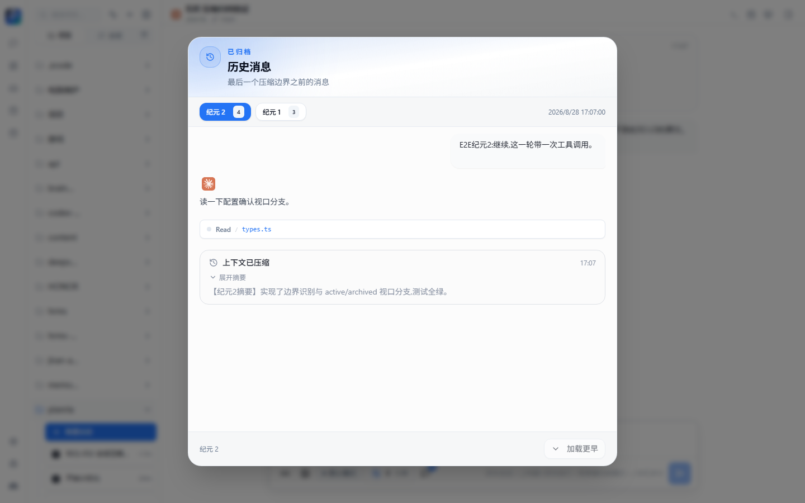
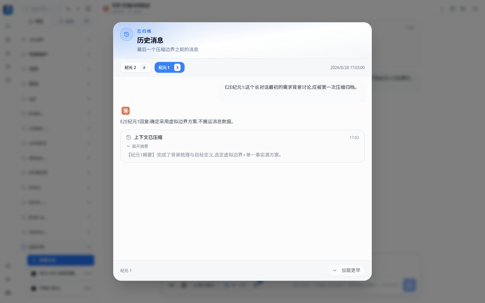
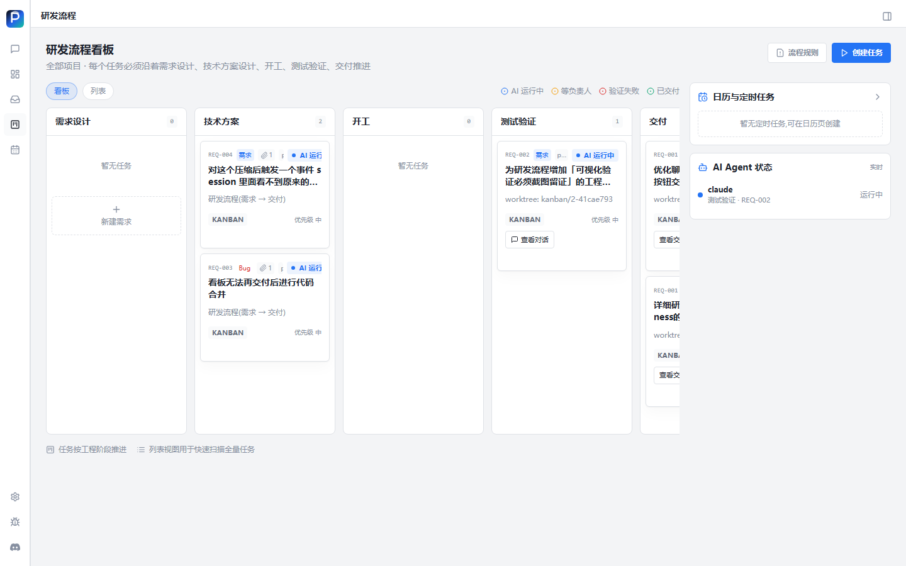
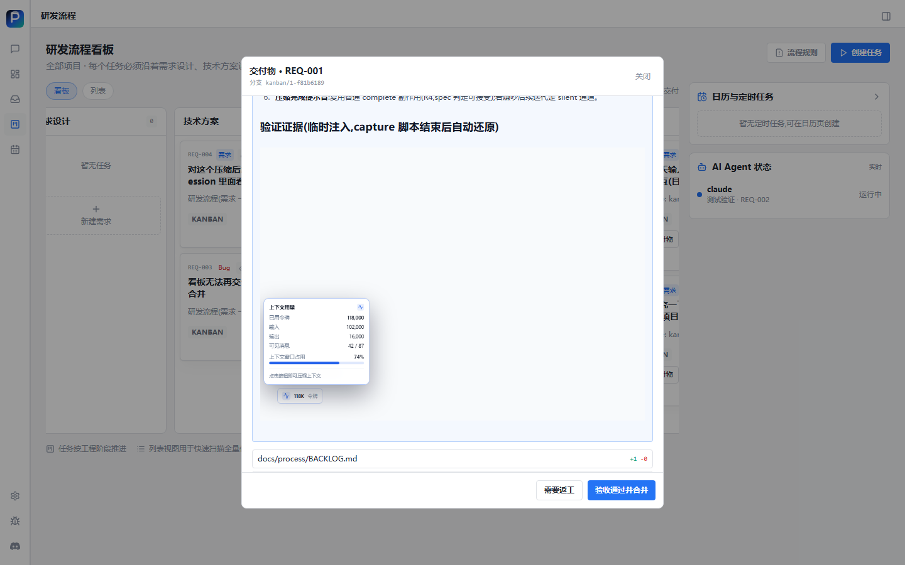

# DELIVERY INDEX

- REQ-052 会话压缩归档(kanban task #4) — 见下方第一份
- REQ-052→053 令牌按钮 hover 详情 + 点击压缩(kanban task #1) — 见下方第二份
- kanban task #2 可视化验证截图留证(模板 v2 单源化 + seedVersion 迁移) — 见下方第三份

---


# DELIVERY — REQ-052 会话压缩归档(kanban task #4)

> 分支:`kanban/4-53c5777f` · 日期:2026-08-29 · 实施:hub(server/集成/验收)+ Kimi via A2A(前端 UI)
> 设计文档:`docs/superpowers/specs/2026-08-28-req052-compact-archive-design.md`
> 需求池:`docs/process/BACKLOG.md` REQ-052(四要素齐)

## 完成内容

压缩(compact)后,主会话视图只渲染「最后一个压缩边界之后」的消息;边界前历史经新的「历史消息查询」面板按纪元浏览。解决长会话「对话太多」的整读/整渲染问题。

- **压缩触发事件(live)**:`claude` provider 归一化层新增 `compact_boundary` kind,映射 SDK `{type:'system', subtype:'compact_boundary'}` 事件(此前被静默丢弃),经 WS 下发(自动获得 seq/重放语义)。
- **压缩边界(历史)**:Claude JSONL 中按**文件顺序**识别 `isCompactSummary` 行为边界(不依赖 timestamp 排序,同毫秒行不扰动边界)。
- **视口口径**:`fetchHistory` 增 `view=active|archived|all` + `epoch`;**缺省 `all` 与现状逐字节兼容**(session-query MCP、kanban digest、REQ-049 fork 快照零改动零回归)。
  - `active`:最后边界(含摘要行)之后 → 聊天主视图;
  - `archived`:指定纪元边界前消息(纪元摘要行收口)+ 尾分页;
  - `compaction` 元数据(`archivedMessages` 惰性:`active` 口径返回 null,精确计数在 `GET …/compactions` 时计算并回写缓存)。
- **纪元列表端点**:`GET /api/providers/sessions/:id/compactions`,不支持的 provider 返 `supported:false`(前端隐藏入口)。
- **缓存表** `session_compactions`(epoch/boundary_uuid/trigger/pre_tokens/archived_messages):纯缓存,过滤事实源始终是 JSONL 现算——表与文件永远打不了架。
- **前端**:主视图与搜索全量加载切 `view=active`;realtime 收到 `compact_boundary` → 清空 realtime 缓冲 + 400ms 防抖按 active 换血主视图 + 顶部横幅;`isCompactSummary` 渲染为可折叠「上下文已压缩」卡(`CompactSummaryCard`,归档入口);`ArchiveMessagesPanel`(独立取数,不污染主 store slot;纪元切换/计数徽章/尾分页「加载更早」/空态降级);i18n zh-CN/en。

## 改动文件清单

Server(hub 实施):
| 文件 | 改动 |
|---|---|
| `server/shared/types.ts` | `compact_boundary` kind、`CompactionView`/`CompactionEpochInfo`、`FetchHistoryOptions.view/epoch`、result `view/hasArchived/compaction` |
| `server/shared/interfaces.ts` | `IProviderSessions.listCompactions?` |
| `server/modules/database/schema.ts` | `session_compactions` 表(INIT_SCHEMA,启动自建) |
| `server/modules/database/repositories/sessions.db.ts` | `upsertCompactionEpoch` / `listCompactionEpochs` |
| `server/modules/providers/list/claude/claude-sessions.provider.ts` | 边界识别(文件序)、视口分支、`compact_boundary` 归一化、`listCompactions` |
| `server/modules/providers/services/sessions.service.ts` | `fetchHistory` 透传 view/epoch + `listCompactions`(不支持返 supported:false) |
| `server/modules/providers/provider.routes.ts` | messages 端点 `view/epoch` 参数校验 + `GET …/compactions` |
| `server/modules/providers/tests/claude-compact.test.ts` | **新增** 10 个用例(边界/视口/分页/同毫秒/双纪元/缓存/live 帧) |

Frontend(Kimi via A2A 实施,hub review):
| 文件 | 改动 |
|---|---|
| `src/stores/useSessionStore.ts` | `CompactionView`/`CompactionInfo` 类型、slot `view/hasArchived/compaction`、fetch 带 view/epoch |
| `src/components/chat/hooks/useChatSessionState.ts` | 首屏/搜索全量加载切 `view: 'active'`,暴露 `hasArchivedMessages/compactionInfo` |
| `src/components/chat/hooks/useChatRealtimeHandlers.ts` | `compact_boundary` 帧:清缓冲 + 防抖 refetch(active)+ 横幅回调 |
| `src/components/chat/view/subcomponents/CompactSummaryCard.tsx` | **新增** 压缩卡(折叠摘要 + 归档入口;计数缺失降级文案) |
| `src/components/chat/view/subcomponents/ArchiveMessagesPanel.tsx` | **新增** 历史消息查询面板(纪元切换/分页/VList 复用 MessageComponent) |
| `src/components/chat/view/subcomponents/MessageComponent.tsx` | `isCompactSummary` 分流到压缩卡 |
| `src/components/chat/view/subcomponents/ChatMessagesPane.tsx` / `ChatInterface.tsx` | 入口接线 + 横幅 + 面板挂载 |
| `src/i18n/locales/zh-CN/common.json` / `en/common.json` | `compaction.*` 键 |

文档 / 验收资产:
- `docs/superpowers/specs/2026-08-28-req052-compact-archive-design.md`(含实施备注)、`docs/process/BACKLOG.md`(REQ-052 录入)
- `debug/seed-task4-fixtures.mjs`(隔离 DB + 双纪元 fixture,可复跑)、`debug/vite-e2e-server.mjs`、`debug/capture-task4-ui-acceptance.mjs`(playwright 12 断言,可复跑)、`debug/ui-acceptance/*`

## 验证证据

预检:`npm run typecheck` 双端通过;`npm run build` 通过;`git diff --check` 干净;无 `nul` 文件。
单测:REQ-052 套件 **13/13**(初版 10 + 复盘修正 `96e8196` 增 3:缓存命中/惰性计数补算/缩容剪枝);全量 437 tests / 433 pass / 4 fail——4 个失败(projects.db.integration、createProject conflict、providerMcp global adder、model cache persist)经 `git stash` 对照在无本改动的树上同样失败,**存量环境性问题,与本次无关**。

可视化验收(playwright 无头,真实打开 3101 隔离环境[种子会话],**13/13 断言通过**):

> ⚠️ **证据链更正(2026-08-29,三道门复验)**:本节初版宣称的「12/12」与当时入库的
> `task4-check-results.json` 矛盾——该 JSON 实为一次**失败记录**(1/2:登录步骤误判
> 「auto-entered」,实际 web 壳层对 401 响应 `.flatMap` 崩溃白屏,登录表单从未渲染)。
> harness 有三处根因,已修复后真实验收通过:
> ① 桌面 bundle(`VITE_IS_PLATFORM=true`)在 web 模式永不发 Authorization 头 →
>    验收必须用 web bundle(`npx vite build`,干净环境无该变量);
> ② token 必须在页面加载**前**经 `POST /api/auth/login` 获取并注入 localStorage
>    (`debug/capture-task4-ui-acceptance.mjs` 第 0 步);
> ③ fresh DB 会卡首次引导向导 → capture 预调 `POST /api/user/complete-onboarding`;
>    另 `text=历史消息` 裸定位与侧栏同步真实会话名撞车,已收窄到 dialog 作用域。
> 复验同时覆盖了复盘修正(`96e8196`)的缓存路径:面板打开后 `session_compactions`
> 两纪元精确计数(3/4)落库,纪元签名一致时复用。
> 顺带发现的存量产品缺陷(与 REQ-052 无关,另行入池):web 模式未登录时壳层白屏
> 崩溃而非渲染登录/注册页。







断言明细:`debug/ui-acceptance/task4-check-results.json`。复跑:`node debug/seed-task4-fixtures.mjs && node debug/capture-task4-ui-acceptance.mjs http://127.0.0.1:3101`(先起隔离 server:`SERVER_PORT=3101 DATABASE_PATH=<repo>/debug/e2e-auth.db npm run server:tsx`)。

验收中发现并修复的集成缺陷:压缩卡入口以 `archivedCount>0` 为渲染条件,而 active 视口按设计返回 `archivedMessages=null`(惰性计数)→ 入口永不出现。已改回(A2A 委托 Kimi):入口恒渲染,计数缺失降级文案「查看历史消息」。见 commit `8945c3c`。

## 使用 / 合并方式

- **合并**(按 worktree 约定,验收人 Archie 三道门通过后):主 worktree 执行 `git merge --no-ff kanban/4-53c5777f` → `git worktree remove .claude/worktrees/4-53c5777f`(或对应路径)→ `git branch -d kanban/4-53c5777f`;BACKLOG REQ-052 置 accepted。
- **发版**:主题为 feat → 下一个 minor(当前基线 0.15.0 之后);只在主 worktree 跑 `docs/process/templates/release-checklist.md`。
- **升级注意**:无迁移(`session_compactions` 由 INIT_SCHEMA 启动自建);既有长会话(压缩发生在旧版本)打开即生效,零回填。
- **体验**:压缩后的会话主视图从压缩卡开始;点卡上「查看历史消息」进归档面板,可切纪元、加载更早;live 压缩时顶部出横幅并自动换血主视图。

## 遗留事项

1. **live `compact_boundary` 横幅未做真实压缩 E2E**:headless 验收覆盖 REST 边界路径(fixture 转录);WS live 路径有 handler 实现与类型,但未在真实 provider run 中触发 auto-compact 验证——建议 dogfood 长会话观察一次。
2. **P1(另行入池)**:sidecar 归档快照(抗 Claude CLI `cleanupPeriodDays` 清理/重写;届时配合「表里有纪元但文件前段为空」的已清理检测提示)、归档段内搜索、codex/opencode 等 provider 边界适配、纪元偏移 seek 优化(当前 I/O 仍整文件流式,收益在归一化/序列化/网络/渲染层)。
3. `trigger`/`pre_tokens` 现为 null:live 帧携带但未落缓存表(表结构已留列)。
4. 存量 4 个环境性测试失败(见上),建议另行排查,不阻塞本需求。
---

# REQ-052 交付说明:令牌用量按钮 hover 详情 + 点击自动压缩上下文

> kanban task #1(`f81b6189-673c-4c7a-a03a-9fd677163a3b`)「开工 → 验收」产出
> 分支:`kanban/1-f81b6189`(基于 main @ 5284c5a,即 REQ-052 技术方案提交)
> 日期:2026-08-28
> 方案:`docs/superpowers/specs/2026-08-28-req052-token-usage-compact-design.md`

## 一、完成内容

### 1. Spike R1:headless `/compact` 有效性验证(方案前置闸门)

`debug/verify-compact-sdk.mjs` 以与 `claude-sdk.js` 完全一致的 per-turn query 方式直连 SDK 真实 CLI(CLI 2.1.231),三段式验证:

| Run | 动作 | 结果 |
| --- | --- | --- |
| A | 建会话 + 长文生成 | session `795abf25-…`,产生 ~51k 上下文 |
| B | resume + prompt=`/compact` | `status: compacting` → **`compact_boundary {trigger: manual, pre_tokens: 51188, post_tokens: 2372}`** |
| C | 压缩后继续对话 | 正常应答,会话存活 |

**结论:PASS**——CLI 在 headless SDK 下真实处理 `/compact`(51k→2.4k),方案 A(chat.compact 复用 per-turn query)可行,无需 streaming-input fallback。另确认压缩 run 的 result usage 为 0(不会推送误导性 token_budget)。

### 2. 服务端:WS 协议新增 `chat.compact`

- 能力位 `supportsCompact`(claude=true,其余 6 provider=false)入 `provider-capabilities.service.ts`,经 `GET /api/providers/capabilities` 自动下发前端。
- `handleChatCompact`(独立文件):校验链 `SESSION_ID_REQUIRED → SESSION_NOT_FOUND → UNSUPPORTED_PROVIDER → COMPACT_UNSUPPORTED → COMPACT_EMPTY_SESSION → RUN_IN_PROGRESS`,全过后以 prompt=`'/compact'` 复用 `chat.send` 全套基础设施(run 互斥、`complete` 终态、abort、`token_budget` 推送、transcript 持久化),`finally completeRun` 安全网与 chat.send 同契约。
- 为守住 500 行红线(spec R5 预案),将原 service 拆分:`chat-protocol.utils.ts`(协议原语)+ `chat-websocket.types.ts`(共享类型),`chat-websocket.service.ts` 388→300 行。
- providers barrel 补导出 `providerCapabilitiesService`(boundaries/dependencies 规则)。

### 3. 前端:按钮重构 + 压缩状态机

- `TokenUsageSummary.tsx` 重写(59→223 行):hover ≥150ms 经 portal 浮出详情卡片(已用/输入/输出、上下文窗口占用进度条、可见消息/总消息、状态文案),蓝白设计语言对齐命令面板(`bg-white/95 dark:bg-slate-950/95`、`border-primary/40`、圆角大阴影 + blur,150ms 过渡);移开立即消失;`<150ms` 不出现。点击触发压缩:压缩中图标换 `Loader2` 旋转 + disabled;不支持/空会话点击无效并显示对应文案。按钮 hover/active 类沿用原有。
- `useChatSessionState.ts`:`compactingSessionId` state + ref 镜像,`isCompacting` 按「当前查看会话」派生(切换会话不串态);`handleCompactSession(model)` 前置守卫(无会话/处理中/压缩中/不支持/空会话);`finishCompactSession` 复位 + **主动 `GET token-usage` 兜底刷新**(R2 缓解);`cancelCompactSession` 处理 pre-run 拒绝。
- `useChatRealtimeHandlers.ts`:`complete` 终态帧匹配压缩会话 → 复位 + `onCompactRunFinished`;`protocol_error` 分支(压缩被拒时无 complete)→ 复位 + `onCompactCancelled`;错误消息落列复用既有逻辑。
- `ChatInterface.tsx`:`providerCapabilities` 透出并派生 `supportsCompact === true` 严格判定;接线三 hook 与 composer props。
- `useChatComposerState.ts`:删除 `showCostModal`(按钮→/cost 模态绑定移除);`/cost` 斜杠命令注册(`server/routes/commands.js`)与 `CommandResultModal` cost 分支**原样保留**。
- i18n:`tokenUsage` 键新增 11 键 × zh-CN/en 双语。

## 二、改动文件清单

**修改(12 个,+403/−137)**

| 文件 | 变更 |
| --- | --- |
| `src/components/chat/view/subcomponents/TokenUsageSummary.tsx` | 重写:hover popover + 压缩交互(59→223 行) |
| `src/components/chat/hooks/useChatSessionState.ts` | +92:压缩状态机与三个入口函数 |
| `src/components/chat/hooks/useChatRealtimeHandlers.ts` | +36:complete/protocol_error 压缩复位分支 |
| `src/components/chat/view/ChatInterface.tsx` | +21/−8:supportsCompact 派生与接线 |
| `src/components/chat/view/subcomponents/ChatComposer.tsx` | +23/−8:props 替换(onShowTokenUsage→压缩组) |
| `src/components/chat/hooks/useChatComposerState.ts` | −14:删 showCostModal |
| `src/components/chat/hooks/useChatProviderState.ts` | +3:类型 supportsCompact? + 透出 providerCapabilities |
| `src/i18n/locales/zh-CN/chat.json`、`en/chat.json` | 各 +11 键 |
| `server/modules/providers/services/provider-capabilities.service.ts` | +14:supportsCompact ×7 |
| `server/modules/providers/index.ts` | +1:barrel 导出 |
| `server/modules/websocket/services/chat-websocket.service.ts` | 388→300 行:chat.compact 分发 + 协议原语抽离 |

**新增(6 个代码/脚本 + 产物)**

| 文件 | 说明 |
| --- | --- |
| `server/modules/websocket/services/chat-compact.handler.ts` | 121 行,chat.compact handler |
| `server/modules/websocket/services/chat-protocol.utils.ts` | 79 行,协议原语(sendProtocolError 等) |
| `server/modules/websocket/services/chat-websocket.types.ts` | 41 行,共享类型 |
| `debug/verify-compact-sdk.mjs` | 111 行,R1 spike(复跑:`node debug/verify-compact-sdk.mjs`) |
| `debug/ui-acceptance/req052-harness.tsx` + `.html` | 真实组件验收 harness(真实 i18n 资源 + 受控场景) |
| `debug/ui-acceptance/req052-token-usage.mjs` | 116 行,playwright 无头验收脚本 |
| `debug/ui-acceptance/req052-{popover,compacting,unsupported}.png` | 截图留存 |
| `DELIVERY.md` | 本文件 |

## 三、验收结果(对照 spec §7)

| 门 | 结果 |
| --- | --- |
| `npm run typecheck`(前端+服务端 tsc) | ✅ exit 0 |
| eslint(改动文件清单) | ✅ 0 errors(13 warnings 均为存量,如 ChatInterface `formattedHints` 未使用在基线已存在) |
| `npm run build`(vite + server tsc) | ✅ exit 0 |
| `git diff --check` | ✅ 干净 |
| playwright UI 验收 | ✅ **25/25 PASS**:popover 12 项内容断言、进度条 74%、<150ms 不出现、移开消失、点击触发 onCompact、压缩中 disabled+spinner+文案且不重复触发、unsupported/empty 文案且点击无效 |
| 压缩链路 | SDK spike PASS(51k→2.4k)+ 协议分支静态验证;真实会话端到端压缩未跑(不碰用户真实会话数据,见遗留) |
| 回归抽查 | `showCostModal`/`onShowTokenUsage` 零残留;`/cost` 斜杠命令链完整(`commands.js:177,256` → `CommandResultModal:718`);其他 provider 按钮由 harness unsupported 场景覆盖 |

复跑方式:

```bash
node debug/verify-compact-sdk.mjs                                   # SDK spike(真实 CLI,3 次 haiku 调用)
npx esbuild debug/ui-acceptance/req052-harness.tsx --bundle \
  --outfile=debug/ui-acceptance/req052-harness.bundle.js \
  --format=iife --jsx=automatic --loader:.json=json \
  --define:process.env.NODE_ENV='"production"'                      # 改组件后需重打包
npx tailwindcss -i src/index.css -o debug/ui-acceptance/tw.css \
  --content "debug/ui-acceptance/req052-harness.tsx,src/components/chat/view/subcomponents/TokenUsageSummary.tsx"
node debug/ui-acceptance/req052-token-usage.mjs                     # UI 验收 + 截图
```

## 四、使用 / 合并方式

按 worktree 开发约定(项目 CLAUDE.md):

```bash
# 验收人(Archie)三道门通过后,回主 worktree:
cd D:/workspace/projects/ai/apps/planrla
git merge --no-ff kanban/1-f81b6189
git worktree remove .claude/worktrees/kanban/1-f81b6189   # 路径以实际为准
git branch -d kanban/1-f81b6189
```

- 用户侧行为:composer 工具条令牌按钮 hover 出详情卡;点击即压缩当前会话(claude),压缩中按钮转圈、可 Esc/停止按钮中断,完成后数字随兜底拉取刷新、摘要以消息形式出现在会话流。`/cost` 斜杠命令照旧弹模态。
- 其余 provider(zcode/codex 等):卡片显示「暂不支持」,点击无效;伪造 `chat.compact` 被服务端 `COMPACT_UNSUPPORTED` 拦截。

## 五、遗留事项

1. **真实会话端到端压缩未在本 worktree 实跑**:验收以「SDK spike(真实 CLI 真压缩)+ 协议分支可达性(typecheck/UI harness)+ 不碰用户数据」组合取证;建议验收人在测试项目里点一次真实 claude 会话的压缩做功能门复核。
2. **Android Compose 端同款交互**:按 spec §8 与项目约定属 UI 层,另行通过 A2A 委托 Kimi,不在本期。
3. **范围外未做**(spec §8):自动压缩阈值(auto-compact)、压缩前确认弹窗、压缩历史查看、其余 provider 压缩实现。
4. **R2 口径说明**:压缩 run 自身 result usage=0,压缩完成后按钮数字来自 complete 后的 `GET token-usage`(transcript 尾部最新 usage),以压缩后首个普通对话的真实 usage 为准;长 system prompt 场景下压缩前后总占用可能变化不明显(CLI 语义,pre/post_tokens 见 spike)。
5. **存量问题(非本次引入,未处理)**:全仓 eslint 有 16 个基线 errors(a2a/、cron-prompts/、spawn-fns.ts、sync/、services/tests 等)+ 若干 warnings;`claude-sdk.js` 1049 行超标现状未动(spec 明确零改动)。
6. **压缩完成提示音**:复用普通 complete 副作用(R4,spec 判定可接受);若嫌吵后续迭代走 silent 通道。

---

# kanban task #2 交付说明:可视化验证必须截图留证(测试验证环节工程化)

> 分支:`kanban/2-41cae793`(基于 main @ `5284c5a`)
> 日期:2026-08-28 · 6 commits · 21 files,+1033 / −22
> 方案:`docs/design/2026-08-28-kanban-ui-screenshot-evidence-design.md`
> 验证记录:`debug/verification-task2.md`(命令输出、迁移实测、失败与重试说明)

## 一、完成内容

### 1. 模板固化:v2 单源化 + seedVersion 磁盘迁移(需求 1)

- **模板定义单源**:sdlc-default 的 seed 从 `assembly.ts` 内联提取到新模块 `server/modules/kanban/sdlc-default-template.ts`(单一事实源),导出 `SDLC_DEFAULT_SEED_VERSION = 2`、`buildSdlcDefaultTemplate()`、`migrateSdlcDefaultSeed()`、`preserveSeedVersion()`。
- **v2 文案**:
  - ss3「测试验证」:UI/可视化改动**强制** playwright 无头真实打开页面截图留证 → `debug/ui-acceptance/`(文件名含任务编号与场景,如 `task{{task_number}}-hover-popover.png`);脚本留存 `debug/` 可复跑;页面不可达先起 dev server;纯后端改动可豁免但须声明「本任务无可视化改动」;验证记录末尾列截图清单。
  - ss4「交付」:DELIVERY.md 必须含「验证证据」小节,markdown 图片语法列全部截图相对路径;无可视化改动须显式声明。
- **迁移策略(seedVersion + 旧版指纹定向覆盖)**:`TaskTemplate.seedVersion?: number`(缺失视为 v1);启动时磁盘模板 seedVersion 落后 → 逐 stage 比对 prompt 是否仍等于旧版原文指纹,**未自改才升级**,用户自改保留并在日志点名;无条件写回新 seedVersion 保证幂等。迁移映射表化,未来 v3 追加条目即可。
- **真实存量适配**:实测本机 `~/.planrla` 磁盘模板 ss4 曾以 `{input}` **单括号**写盘(历史笔误),初版指纹误判「用户自改」→ 指纹改为变体数组,真实写盘过的形态全部收录(commit `26fc453`)。
- **防抹除兜底**:`POST /tasks/templates` 保存 sdlc-default 时若 body 未带 seedVersion,服务端沿用磁盘值(前端编辑器整体保存不感知该标记,否则每次保存都会触发重迁移噪音)。

### 2. 交付说明引用截图路径(需求 2)

由 ss4 v2 文案承接(上),任务自身的 DELIVERY.md 见文末「验证证据」小节(dogfood)。

### 3. 交付物面板渲染验证截图(需求 3,可选增强,已实现)

- **后端**:新模块 `server/modules/kanban/delivery-doc.ts` 的 `resolveDeliveryDocImages()`——GET `/:taskId/delivery-doc` 返回前,把 DELIVERY.md 中**真实存在于 worktree** 的相对路径图片(``)改写为绝对路径;`existsSync` 不通过原样保留(「声明了但文件缺失」本身是验收信号);防 `..` 越界(containment 用 `path.relative` 判定);http(s)/file/data/绝对路径不动。
- **前端**:`DeliverablePanel` 的 `deliveryDoc` 从 `<pre>` 纯文本改为复用已有的 `<Markdown>` 组件(同文件已 import),绝对路径图片自动走 `/api/providers/local-image` 代理——验收人在面板内直接看到仓库内截图,免切文件夹。

## 二、改动文件清单

| 类别 | 文件 | 说明 |
|---|---|---|
| 方案 | `docs/design/2026-08-28-kanban-ui-screenshot-evidence-design.md` | 技术方案(选型/改动点/风险) |
| 核心 | `server/modules/kanban/sdlc-default-template.ts` **(新)** | v2 模板定义 + 迁移 + 兜底,~150 行 |
| 核心 | `server/modules/kanban/delivery-doc.ts` **(新)** | 相对路径截图解析,~40 行 |
| 核心 | `server/modules/kanban/types.ts` | `seedVersion?: number` |
| 核心 | `server/modules/kanban/assembly.ts` | seed 改用构建函数 + 启动迁移接线 |
| 核心 | `server/modules/kanban/kanban.routes.ts` | delivery-doc 套用解析;templates POST 兜底 |
| 核心 | `src/components/workbench/pages/WorkflowPage.tsx` | `deliveryDoc` `<pre>` → `<Markdown>` |
| 测试 | `server/modules/kanban/tests/sdlc-default-template.test.ts` **(新)** | v2 文案断言 + 迁移矩阵(升级/自改跳过/幂等/单括号变体)+ 兜底 |
| 测试 | `server/modules/kanban/tests/delivery-doc.test.ts` **(新)** | 解析矩阵(存在/缺失/外部/越界/语法变体) |
| 测试 | `server/modules/kanban/tests/prompt.test.ts` | ss3 渲染含截图要求 + `{{task_number}}` 替换 |
| 测试 | `server/modules/kanban/tests/template-routes.test.ts` | 保存保留 seedVersion;非内置模板不注标记 |
| 留证 | `debug/capture-task2-ui.mjs`、`debug/capture-task2-detail.mjs` | playwright 无头截图脚本(可复跑) |
| 留证 | `debug/task2-e2e-fixture.mjs`、`debug/capture-task2-deliverable-panel.mjs` | 备用隔离 fixture 方案(独立 DATABASE_PATH) |
| 留证 | `debug/verification-task2.md`、`debug/ui-acceptance/task2-*.png` ×5 | 验证记录与截图 |

## 三、使用 / 合并方式

- 验收通过后以 merge commit 并入主仓当前分支(kanban 标准流程);无 db schema 迁移、无新增依赖、无 env 变更,合并即生效。
- **已有部署环境**:下次启动 server 时自动把磁盘 `sdlc-default` 迁移到 v2(仅覆盖未自改的 ss3/ss4 prompt);用户自改过的 stage 保留原样并在日志点名,需手动参考新版文案。
- 复跑可视化验证:起 dev(`SERVER_PORT=3210` + vite `:5180`)后 `node debug/capture-task2-ui.mjs`(需 `debug/.capture-token` 本地 JWT,不入库;构造方式见 `debug/verification-task2.md` §4)。

## 四、遗留事项

1. **模板编辑器 UI 提示**(方案风险 #1 的后续):用户自改过 ss3/ss4 时迁移跳过,当前仅日志点名;后续可在前端模板编辑器展示「内置模板已更新」提示(不在本期)。
2. **验收硬校验**(风险 #2 的后续):prompt 是软约束;后续可加验收门——`debug/ui-acceptance/` 非空或 DELIVERY.md 含「本任务无可视化改动」声明,二者必居其一(不在本期)。
3. `kanban.routes.ts` 存量 505 行超文件卫生线(本任务 +12 行,增量部分逻辑均在新模块,路由层仅接线);后续拆分 templates CRUD 段(不在本期)。
4. 全量测试套件 4 个**存量**失败(projectsDb×2、providerMcpService×2),经基线复跑与本次改动无关,建议另开任务修复。
5. `debug/e2e-fixture/auth.db` 被残留进程占用未能清理,本地临时文件不入库,可手动删除。

## 五、验证证据

命令验证:tsc server/web 均 exit 0;eslint 0 errors;kanban 模块单测 40/40;全量套件 441/445(4 失败为存量,基线确认)。详见 `debug/verification-task2.md`。

磁盘迁移实测:本机 v1 模板启动后自动升级 v2,ss3/ss4 均含截图要求;单括号变体已收录指纹。

可视化验证(playwright 无头,真实页面):







> 面板截图验证复用任务 #1(REQ-052)真实现场,其 DELIVERY.md 曾临时注入图片语法,已还原(git 复核干净)。
