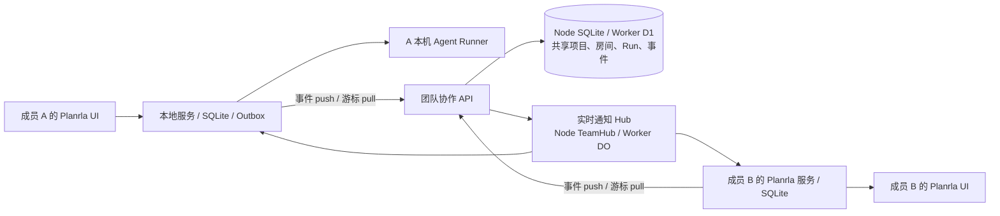

# Planrla 团队 Agent 任务房间技术设计

状态：设计稿，待用户审阅  
日期：2026-09-23  
范围：团队共享项目、任务协作房间、Agent Run 协调与跨实例事件同步；不包含中央 Agent 执行服务。

## 1. 目标与边界

### 目标

- 团队成员围绕同一共享项目/任务查看讨论、任务状态和 Agent 运行进度。
- 每次 Agent Run 由明确的成员和 Planrla 实例负责，实际 Agent 仍在该成员本机运行。
- 断线后可从持久化游标补齐事件；本地 Agent 不因云端暂时不可用而中断。
- 复用现有团队账号、成员、实例注册、Kanban、团队消息、SQLite、Node 同步服务和 Worker/D1 API 契约。

### 非目标

- 云端执行命令或访问成员机器上的仓库。
- 默认同步完整 Agent transcript、工具调用参数、代码文件、diff 或本地绝对路径。
- 在首版引入通用生活/工作群聊、独立消息队列、Redis 或新的身份服务。
- 移除既有本地 Agent 聊天、Inbox、审批和任务功能。

### 成功标准（首版建议）

- 团队成员可以把各自本地项目明确绑定到一个共享项目，并在房间中看到一致的共享任务。
- 同一任务至多一个有效团队 Run；Run 事件可实时通知、断线可补拉、重复投递不会重复显示。
- 云端只收到明确允许共享的消息、状态和摘要；本地 session ID、路径、原始 transcript 和工具输入不进入云端。
- Node/SQLite 与 Worker/D1 对同一协作 API 契约通过一致性测试。

## 2. 当前实现与约束

- `planrla/server/modules/sync/sync.client.ts` 每 30 秒执行任务及团队消息 push/pull；水位目前基于时间戳。
- `planrla/server/modules/sync/sync.db.ts` 使用单行 `sync_config` 保存当前团队、实例 token 和同步水位，因此当前每个 Planrla 安装实际上只配置一个活动团队。
- `planrla/server/modules/team-messages/` 已提供本地消息存储、REST 路由和本机 WebSocket 广播；云端 `team_messages` 记录团队消息及来源实例。
- 本地 `projects.project_id` 与 `project_path` 绑定；路径是机器本地数据。现有共享任务的 `root_id` 直接跨实例传输，没有共享项目 ID 到本地项目 ID 的显式映射。
- `planrla-cloud/node/src/index.ts` 与 Worker 版本实现相近的团队/同步 API。仓库中的 `deploy/Caddyfile` 和 `deploy-relay.sh` 指向 Node 服务部署路径；真实生产后端需在实施/上线前再次核实。
- 主仓存在大量预先存在的未提交改动。实现时须保留这些改动，不做清理或重置。

## 3. 总体架构

采用“本地执行 + 云端协作状态 + 易失实时通知”的分层。数据库事件是事实来源，WebSocket 只通知客户端有新游标；漏通知由游标拉取补齐。



Node 首先实现团队 Hub，适配当前单进程部署；Worker 使用独立的房间 Durable Object。实时层不复用设备 `/relay` 通道，避免混淆设备访问 token 与团队协作身份。若实际生产已迁至 Worker，应先确认部署路径，再决定 Node/Worker 的实现顺序。

## 4. 核心数据模型

字段为逻辑草案；实际类型遵循现有 SQLite/D1 风格。所有云端行均含 `team_id`，读写必须按授权团队限定。

### 云端

| 表 | 关键字段/约束 | 职责 |
|---|---|---|
| `team_projects` | `id`, `team_id`, `name`, `created_by`, timestamps | 团队内稳定的共享项目身份；不保存本地路径 |
| `instance_project_bindings` | `team_id`, `instance_id`, `shared_project_id`, `local_project_id`, `status`; 唯一键 `(instance_id, local_project_id)` | 各机器本地项目与共享项目的显式绑定 |
| `team_rooms` | `id`, `team_id`, `shared_project_id`, nullable `task_id`, `title`, `status`, `created_by`, `version`, timestamps | 项目/任务协作空间；成员权限首版继承团队成员 |
| `agent_runs` | `id`, `team_id`, `room_id`, `task_id`, `owner_user_id`, `owner_instance_id`, `provider`, `status`, `lease_until`, `summary`, timestamps, `version` | Run 元数据、负责人、状态与任务级并发控制 |
| `team_room_events` | `cursor INTEGER PRIMARY KEY AUTOINCREMENT`, `event_id` 唯一, `team_id`, `room_id`, `run_id`, `actor_user_id`, `actor_instance_id`, `type`, `payload_json`, `created_at` | 房间时间线的持久化、幂等、可分页事件源；cursor 为服务端全局递增序号，读取时仍按 team/room 授权过滤 |

`team_room_events` 中可包含 `message.created`、`run.started`、`run.progress`、`run.approval_required`、`run.summary`、`run.completed`、`run.failed`、`run.cancel_requested` 等类型。客户端不能指定 `cursor` 或伪造 actor 身份。

现有 `shared_tasks` 继续保存可移植任务字段，但同步协议增加 `shared_project_id`。云端不再把发送方本地 `project_id` 当作共享项目身份。任务状态冲突暂时沿用已有策略；Run 状态不使用 LWW。

现有 `team_messages` 在过渡期保留为兼容表/本地 Inbox 投影。新房间消息以 `team_room_events` 为权威源；迁移历史时，只有能通过来源实例与本地绑定明确匹配的记录才自动映射，其他记录由成员确认，不按项目名或路径猜测。

### 本地 SQLite

- `team_collab_outbox(event_id PRIMARY KEY, team_id, room_id, payload_json, created_at, attempts, last_error)`：事件先落本地，再异步上传；收到云端确认后标记已完成或删除。
- `team_event_cursors(team_id, room_id, cursor)`：按房间保存拉取位置。
- `local_project_bindings(team_id, shared_project_id, local_project_id, linked_at)`：仅存本地项目 ID 和映射；本地绝对路径不出机。
- `local_run_links(run_id PRIMARY KEY, local_session_id, local_project_id)`：本地 Run 与现有 session 的关联，不上传 session ID。

当前 `sync_config` 是单团队配置。首版默认沿用“每个 Planrla 安装一个活动团队”的现有限制；如果产品要求一台安装同时同步多个团队，应在实现前把团队凭据/游标归一化为按 `team_id` 多行配置，并升级同步调度器，不能把多个团队 token 塞入单行配置。

## 5. API 与身份边界

浏览器继续调用本机 Planrla API；本机服务代理成员操作到云端。后台同步由本机 SyncEngine 发起。

### 成员 JWT API（逻辑端点）

- `GET/POST /api/teams/:teamId/projects`：列出/创建共享项目。
- `POST /api/teams/:teamId/projects/:projectId/bindings`：绑定当前实例的本地项目；本地路径只传本机服务，不上云。
- `GET/POST /api/teams/:teamId/rooms`：列出/创建房间。
- `GET /api/rooms/:roomId/events?after=<cursor>&limit=<n>`：按游标分页拉取时间线。
- 本机 `POST /api/rooms/:roomId/messages`：本地认证后写入 outbox；不直接向云端写消息。

### 实例 token API（后台）

- `POST /api/sync/rooms/:roomId/events`：推送 outbox 批次，按 `event_id` 幂等；actor 和团队由 token 推导。
- `POST /api/sync/rooms/:roomId/runs`：创建 Run 并原子申请 task 租约；幂等键防止客户端重试产生多个 Run。
- `POST /api/sync/runs/:runId/heartbeat`：更新执行租约。
- `POST /api/sync/runs/:runId/transition`：依据当前状态/版本更新 Run 状态；检查 owner instance 与有效租约。
- `GET /api/sync/rooms/:roomId/events?after=<cursor>&limit=<n>`：离线补拉。
- 新增独立协作 WebSocket 连接用于通知；断线不丢数据，始终由 REST 游标接口恢复。

成员 JWT 用于团队、共享项目、绑定和房间等交互式管理操作。消息及 Run 事件先写本机 outbox，再由后台实例 token 上传；该 token 只能代表注册时绑定的一个用户/实例/团队。Run 创建/租约是单独的实例认证操作，本机服务须先验证当前交互用户和实例归属，再发起云端原子申请。云端必须从认证凭据推导 `team_id`、`user_id`、`instance_id`，并验证成员仍在团队、房间属于团队、实例绑定了该共享项目。请求体中的身份字段一律不作为授权依据。

## 6. Run 生命周期与并发

```text
requested → accepted → running ↔ waiting_approval → succeeded | failed | cancelled
                                      └────────────→ stale（失联，待人工处理）
```

1. 用户从本地房间启动 Run；本机服务验证本地绑定和会话权限。
2. 云端事务/条件更新为该 task 申请唯一有效租约；竞争失败返回 `RUN_ALREADY_ACTIVE`，不得启动本地 Agent。
3. 本地服务将 `run_id` 映射到现有 provider/session 并执行；云端不下发任意 shell 命令。
4. 本地状态先写 outbox，再上传；在线时通知其他房间成员，离线时等待恢复。
5. Run 完成后只上传状态与经用户允许的摘要/产物引用。

租约过期先进入 `stale`，不自动释放给其他实例。用户确认旧进程停止后才能重试/接管，避免网络分区造成双重执行。首版审批留在运行机器的现有本地审批 UI；其他成员只能提出审批/取消请求，不能直接批准本机工具调用。团队 Run 无法取得云端租约时不启动；普通本地 Run 不受影响。

## 7. 事件与实时协议

- 客户端生成 UUID `event_id`；云端唯一约束去重并返回原事件的 cursor，保证重试安全。
- 云端以事件表自增主键分配全局递增 cursor；拉取按 `team_id + room_id + cursor > after`、稳定排序和 limit 分页，不用客户端墙钟作为唯一同步水位。
- 新消息和 Run 事件写入事件源后再广播。通知只携带房间 ID、最高 cursor，客户端再拉取完整事件。
- 每个房间独立保存游标；较大历史需分页。消息文本保留现有长度限制，并对 JSON payload、批次大小和事件频率设上限。
- 本地收到事件后按 `event_id` 幂等写入本地投影，再触发现有本机 WebSocket 广播；重复事件不重复显示。

## 8. 隐私、安全与权限

- 默认不上传原始 transcript、工具参数、代码文件、diff、密钥、机器路径或本地 session ID；分享片段/产物必须由成员主动选择。
- 运行机器保留本地工具权限和 human approval gate；云端 Run API 只能创建受限 Run 元数据，不能直接调用 CLI。
- 团队/房间/项目/事件每个读写 API 都做团队成员及项目绑定校验；检查跨团队 IDOR、离队后的 token 失效和重复邀请码使用。
- 邀请码应可轮换/撤销；实例 token 应能撤销/轮换。token 不返回给浏览器，也不写日志。现有云端 token 存储方式需在实现安全评审中单独检查，不在本设计阶段修改认证配置。
- 事件采用 append-only 便于游标和审计；团队/项目删除及保留期限需定义可执行策略，避免将“不可变事件”误解为永远不可删除。
- TLS 保护传输。服务端只记录必要 actor 与操作元数据；对用户消息内容的访问和删除策略需纳入隐私说明。

## 9. 失败模式与非功能目标

| 故障/竞争 | 预期行为 |
|---|---|
| 云端短暂不可用 | 本地 Agent 持续运行；事件保留 outbox 并退避重试；无法取得租约的新团队 Run 不启动 |
| WebSocket 断连/通知遗漏 | 重连后从最后 cursor 分页补齐；事件 ID 去重 |
| 上传重复或乱序 | 唯一 `event_id` 幂等；服务端 cursor 排序；状态变更做版本/状态迁移检查 |
| Agent 所在机器失联 | Run 转为 `stale` 并提示人工确认，不自动释放任务租约 |
| 两实例同时启动同一任务 | 数据库原子租约只允许一个成功；失败方显示当前 owner/status |
| 成员被移出团队 | 所有后续请求即时拒绝；其实例凭据撤销或失效 |

首版建议目标：在线事件通知 p95 < 2 秒；网络恢复后自动补齐事件；云端事件 API 故障不得阻塞已经运行的本地 Agent。具体容量、事件保留时间和可用性目标应在实际使用人数/预算确定后定标，不按假设规模引入额外基础设施。

## 10. 迁移与发布阶段

1. **共享项目身份**：增加共享项目和本地绑定；未绑定数据暂停跨实例导入。提供人工映射旧任务的流程。
2. **事件 outbox 与游标**：增加本地 outbox、云端事件表和 cursor 分页 API；迁移团队消息写入新事件源，保留 Inbox 兼容投影。
3. **房间与通知**：任务房间 API/UI、独立实时通知连接、断线补拉；先按当前部署确认的 Node 或 Worker 目标上线，另一后端共享契约测试。
4. **Agent Run**：租约、Run 状态机、本地 runner 接入、结构化脱敏事件、stale 人工恢复。
5. **权限与运维收尾**：成员/实例撤销、邀请码轮换、事件限流、保留/删除策略、指标和报警。

建议指标：同步延迟、outbox 队列长度/最老事件年龄、游标补拉量、WebSocket 在线数、Run 成功/失败/stale 数、租约竞争拒绝数、跨团队授权拒绝数。日志不得包含完整消息敏感字段或 token。

## 11. 验证计划

- 单元测试：项目绑定转换、Run 状态机、租约竞争、事件 schema 校验与脱敏、cursor 分页。
- SQLite 集成测试：outbox 重试、事件幂等、任务到共享项目映射、删除/离队后的访问拒绝。
- 后端契约测试：同一组团队/房间/事件测试分别运行在 Node/SQLite 与 Worker/D1 实现。
- 端到端：A 启动任务 → B 收到 Run 状态 → B 评论 → A 收到评论 → A 完成并分享摘要；断网后重连补齐且不重复。
- 安全回归：跨 team/room/project IDOR、伪造 actor、撤销 token、共享未绑定项目、越权批准工具操作。
- 故障注入：重复和乱序投递、Node/云端重启、机器失联、云端不可用、租约到期和人工恢复。

## 12. 架构决策记录（草案）

### ADR-1：Agent 在成员本机执行

**决策：**团队协作云端只协调共享状态，不托管 CLI/仓库执行。  
**理由：**保留现有本地 provider、账号订阅、文件权限和审批边界。  
**代价：**负责人机器需要在线；云端不能保证任意时刻代跑。

### ADR-2：显式共享项目绑定

**决策：**为团队共享项目创建稳定 ID，并将其显式映射到每个实例的本地项目 ID。  
**理由：**路径和本地 `project_id` 不构成跨机器身份。  
**代价：**成员首次加入项目需要人工绑定与旧数据确认。

### ADR-3：持久化事件源，实时层只负责通知

**决策：**事件先存 SQLite/D1，Hub/DO 只广播 cursor；断线通过 REST 补拉。  
**理由：**复用现有数据库和同步设施，避免把 WebSocket 当可靠队列。  
**代价：**需要维护 outbox、事件分页和 cursor 兼容。

### ADR-4：Run 使用租约/状态机而非 LWW

**决策：**运行竞争由服务端原子租约解决；失联 Run 标 `stale` 并人工确认。  
**理由：**LWW 适合部分任务字段，不足以防止两台机器同时执行。  
**代价：**网络分区时可用性让位于避免重复执行。

### ADR-5：默认最小化云端数据

**决策：**云端默认存团队消息、结构化状态与摘要，不存完整 Agent transcript、代码或工具输入。  
**理由：**减少敏感数据暴露并契合本地优先执行模式。  
**代价：**协作者不能直接查看负责人完整的模型对话。

## 13. 实施前需确认

1. `api.planrla.com` 当前真实运行的是 Node/VPS 还是 Worker；仓库部署文件仅提供线索。
2. 首版是否接受每个 Planrla 安装仅配置一个活动团队；若不接受，需把多团队本地同步上下文纳入 Phase 1。
3. 团队项目的删除/退队后数据保留周期，以及消息删除对事件审计的影响。
4. 多人审批是否继续限定为运行机器本地审批（本稿默认是）。
